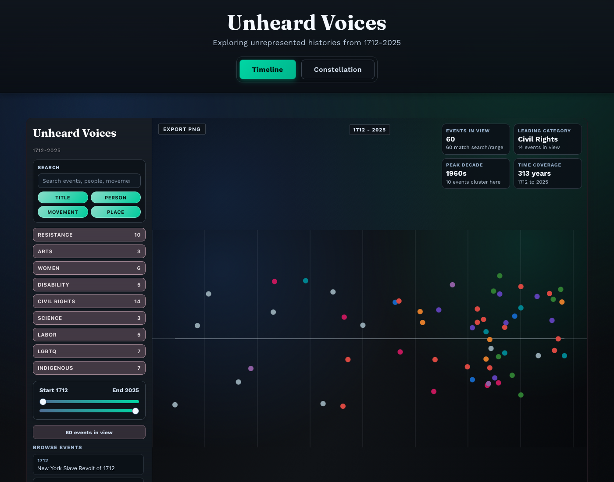

# Unheard Voices

Unheard Voices is an interactive timeline of 60 curated historical events that mainstream history tends to skip, built for people who want to see how a React app draws its own Canvas 2D visualization without a charting library. It is a portfolio piece, not a flagship product, and the dataset is deliberately small.

```bash
pnpm install && pnpm dev
```



**Live:** https://un-heard-voices-8xof.vercel.app/

## How it compares

The obvious neighbour is [Histography](https://histography.io) by Matan Stauber, and it does the two things this cannot: it scans Wikipedia for a much larger set of events and plots history back to the Big Bang, and it has been live and widely cited since 2015, so it has a decade of readers and fixes behind it. This project carries 60 hand-picked events over 1712 to 2025 and exists to show the renderer, so treat the dataset as the weak part. Where this one differs is stability: Histography builds a new graph layout each time you pick a timeframe, while here every position comes from event identity, so filtering out a category never shuffles the view you are reading.

## What it does

Two views share one canvas element and one set of filters.

- Timeline: events plotted chronologically, for seeing what happened when.
- Constellation: events placed on a polar field of rings, for seeing the whole set at once.

The filter rail covers year range, category, and search. Search runs over titles and descriptions, people, movements, places, and regions, and scope toggles narrow it to titles, people, movements, or places. A summary strip above the canvas reports events in view, the leading category, the peak decade, and the span of years covered.

Every piece of UI state lives in the URL query string (`view`, `start`, `end`, `categories`, `event`, `q`, `scope`), so any view you reach is a link you can send.

The canvas takes keyboard input. Arrows move the highlight, `Home` and `End` jump to the ends, `Enter` or `Space` opens the detail panel, and `Escape` closes it. Selecting an event opens a panel with its description, a link to its Wikipedia article, tag pills, and three lists: influenced by, same movement, same region. An event list in the same rail mirrors the visible events as buttons, so every entry is reachable without the canvas, and the current canvas can be downloaded as a PNG.

## What it does not do yet

- The constellation draws no lines between events. Influences and shared movements or regions exist as metadata, and they appear as lists in the detail panel, not as edges on the canvas.
- Neither view pans or zooms. The layout fits the whole visible set into the canvas box.
- No TypeScript. The JSX is untyped and there is no `typecheck` script, so `pnpm lint` and the tests are the only automated checks on shape.
- The rendering is tuned for 60 events. There is no virtualization, and nothing has been measured past a few hundred.
- No backend, accounts, or saved state. A view survives as a URL and nowhere else.

## The dataset

60 events in `src/data/events.json`, each with an id, a title, an integer year in `date`, a display `year` string (one entry is `c. 1730`), a category, a description, and a Wikipedia article title. Entries run 1712 to 2025, and the schema test allows 1700 to 2026. The categories are `arts`, `civil_rights`, `disability`, `indigenous`, `labor`, `lgbtq`, `resistance`, `science`, and `women`.

The people, places, movements, regions, and influence links behind the detail panel and the search scopes live in `EVENT_METADATA`, in the same file as the renderer.

## Run it

Node 22 or newer, pinned in `mise.toml`.

```bash
pnpm install
pnpm dev        # localhost:5173
```

Other scripts:

```bash
pnpm test         # vitest run
pnpm test:watch
pnpm lint         # eslint src tests *.config.js
pnpm build        # -> dist/
pnpm preview      # serve the production build
```

## How it is built

Vite 8 and React 19, plain JSX. The visualization is a hand-written Canvas 2D renderer in `src/components/HistographyVisualization.jsx`: no D3, no charting library, no force simulation. `src/App.jsx` owns the URL-synced state and passes it down. Pure logic lives in `src/lib/` so it can be unit tested without a canvas.

The canvas is authored in CSS pixels and the backing store is scaled by `devicePixelRatio`, so hairlines stay sharp on a retina display. The category rail collapsing or the window moving between displays both trigger a redraw.

```
src/
  App.jsx              # state, URL sync, filter controls
  components/
    HistographyVisualization.jsx  # canvas renderer, detail panel, EVENT_METADATA
  data/events.json     # the dataset
  lib/                 # pure, unit-tested logic
    canvasGeometry.js  # DPR-aware sizing, coordinate mapping
    interaction.js     # tooltip clamping, keyboard index resolution
    starLayout.js      # deterministic constellation positions
    exportImage.js     # PNG download
  styles/              # index.css, timeline.css
tests/                 # vitest + jsdom
```

## Tests

`pnpm test` runs nine vitest files in jsdom: the dataset schema, the geometry and layout functions, tooltip clamping and keyboard index resolution, DPR-aware canvas sizing, mobile layout, and PNG filename derivation.

## Deploy

Pushes to `main` build on Vercel using `vercel.json` (`pnpm install --frozen-lockfile`, `pnpm run build`, output `dist`). That output is a plain static bundle and can be hosted anywhere.

## If it doesn't work

```bash
rm -rf node_modules && pnpm install
```

## Writing about it

[Building a canvas timeline that doesn't lie about where things are](blog/building-a-canvas-timeline.md) covers `devicePixelRatio`, hit targets, and why the layout stopped moving when you filter.

Contributing? See [CONTRIBUTING.md](CONTRIBUTING.md).
